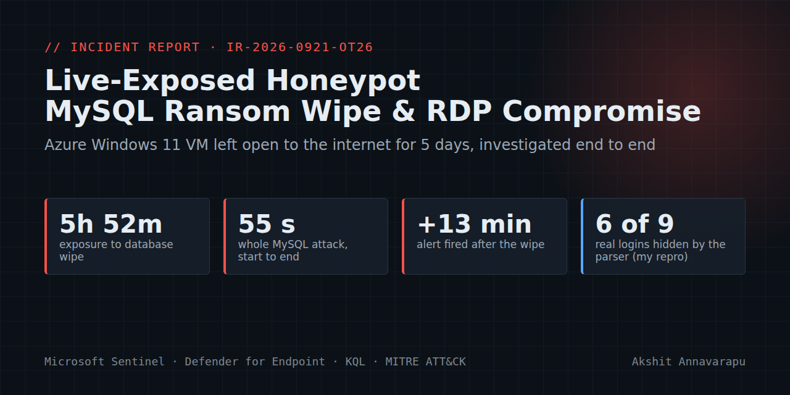


# Incident Report: MySQL Ransom Wipe and RDP Admin Compromise on an Exposed Honeypot

| | |
| :--- | :--- |
| **Incident ID** | `IR-2026-0921-OT26` |
| **Severity** | High (lab data; the production equivalent would be a reportable breach) |
| **Classification** | Unauthorized access with valid accounts → database theft, destruction and extortion; local admin credential compromise with interactive RDP |
| **Affected asset** | `CORP-OT26-0400AP` (Azure Windows 11 VM, MySQL 8.0 on 3306, RDP on 3389). Defender shows it as `corp-ot26-0400a` because MDE truncates names to 15 characters |
| **Incident window** | 2026-09-20 22:24 UTC (exposed) → 2026-09-25 22:11 UTC (isolated) |
| **Tooling** | Microsoft Sentinel, Defender for Endpoint (Advanced Hunting, investigation packages), KQL |
| **Analyst** | Akshit Annavarapu |
| **Report date / version** | 2026-10-03, v1.1 (adds the investigation-package forensics and corrects v1.0) |

> **Context.** This honeypot ran on an Azure Windows 11 VM, built using a guided cloud security lab that provides the environment and setup steps. The investigation, the KQL hunts, the parser-bug reproduction (section 6) and the host forensics (section 7) are my own work. I used an AI assistant for parts of the log analysis and drafting, and I checked every finding with my own queries. All times in the text are **UTC**; the portal screenshots display **EDT (UTC−4)**.

---

## Key findings

- **The database was gone 5 h 52 min after exposure.** A bot logged in to MySQL as `root` and, within 55 seconds, read all 31 tables, dropped all four databases, purged the binary logs, left a Bitcoin ransom note and revoked root's privileges.
- **The Windows `administrator` password fell in 3 h 41 min.** On 23 Sep an intruder from `105.155.100.147` (workstation `DESKTOP-OU4DIV8`) opened a real RDP desktop session.
- **No malware, persistence or outbound C2 was found.** The baseline and mid-incident investigation packages differ only by Windows per-user services and OneDrive tasks.
- **Detection failed, and I found out why.** The lab's MySQL logon parser hid real logins, including the bot's first successful one. I reproduced the bug on the live server: one service restart hid 6 of 9 successful logins. I wrote a fixed query (Hunt 6.1).
- **The response was slow.** The MySQL alert fired 13 minutes *after* the wipe, and both incidents still had the status New when I isolated the host.

### Where the attacks came from

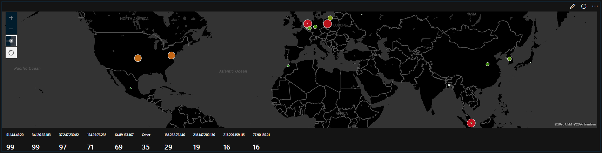

*Attack sources by geolocation (Defender Advanced Hunting, Sentinel workbook). Size/colour = attempts. The four IPs that actually logged in (36.62.38.51, 200.75.2.138, 218.147.202.136, 105.155.100.147) were low-volume; the large bubbles were sprayers that never got in.*

### Attack flow

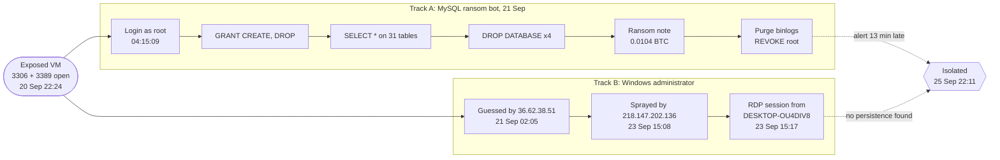

## Contents
1. [Summary](#1-summary)
2. [Incident details and impact](#2-incident-details-and-impact)
3. [Indicators of compromise](#3-indicators-of-compromise)
4. [Timeline](#4-timeline)
5. [MITRE ATT&CK mapping](#5-mitre-attck-mapping)
6. [Root cause, and why detection failed](#6-root-cause-and-why-detection-failed)
7. [Host forensics: investigation package comparison](#7-host-forensics-investigation-package-comparison)
8. [Response actions](#8-response-actions)
9. [Lessons learned and detection improvements](#9-lessons-learned-and-detection-improvements)
10. [Evidence and limitations](#10-evidence-and-limitations)
11. [Conclusion and final scope](#11-conclusion-and-final-scope)
12. [Appendix: KQL hunts](#appendix-kql-hunts)

---

## 1. Summary

On 20 September 2026 I exposed a Windows 11 VM running MySQL to the internet. The NSG allowed all inbound traffic, Windows Firewall was off and the passwords were weak. Two separate intrusions followed.

**Track A: MySQL ransom bot (21 Sep, 04:15:08–04:16:03)**

The bot at `64.89.163.176`:
1. **Gained access.** A blank-password attempt as `root` was denied. The next connection, under a second later, authenticated.
2. **Granted itself privileges.** It ran `GRANT CREATE, DROP ON *.* TO root@'%'`.
3. **Collected data.** It ran `SELECT *` on all 31 tables in `lnp_corp`, `sakila` and `world`, including `lnp_corp.credentials`, `customers`, `orders` and `payments`.
4. **Destroyed data.** It ran `DROP DATABASE` four times.
5. **Left a ransom note.** It created `RECOVER_YOUR_DATA.RECOVER_YOUR_DATA`, demanding **0.0104 BTC** within 48 hours.
6. **Blocked recovery.** It ran `RESET MASTER` and `PURGE BINARY LOGS`, then `REVOKE ALL` on `root@'%'`, then `SHUTDOWN`. The server stayed up.

Two other hosts in the same /24 re-ran the routine on 21 and 23 Sep. Three more IPs logged in as root and ran only inventory queries.

**Track B: Windows administrator compromise (21–23 Sep)**

1. `36.62.38.51` guessed the `administrator` password after two failures (21 Sep, 02:05).
2. On 23 Sep, `218.147.202.136` sprayed 553 NTLM logons across dozens of usernames and hit `administrator` at 15:08:10.
3. Nine minutes later, `105.155.100.147` logged in on the first try. It had failed twice as `AZUREUSER` two hours earlier. It then opened an RDP desktop from `DESKTOP-OU4DIV8` (15:17:28) and launched Settings and Task Manager. Two minutes in, the Security log shows two wrong-password attempts on the lab-owner account from inside the machine (15:19:16–18), most likely from that session. The session went idle around 15:19 and was still disconnected at 18:05.

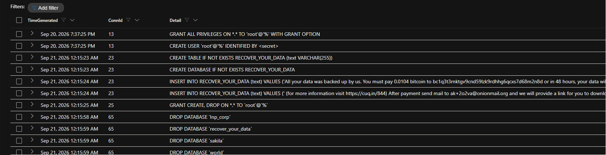
*Hunt 3.1: the bot's destructive and privilege statements (times shown in EDT).*

---

## 2. Incident details and impact

| Field | Detail |
| :--- | :--- |
| First detectable malicious event | 21 Sep 02:05:00: `administrator` LogonSuccess from `36.62.38.51`. MySQL: 04:15:09 |
| Alerts | VM logon rule: incident 521098 at 00:37:42 on 21 Sep. It was first triggered by my own test logon. MySQL rule: incident 521382 at 04:29:17, **13 min after the wipe** (Hunt 2.1) |
| Incident status at isolation | Both incidents were still **New**, unworked for about 5 days |
| Confirmed | 25 Sep 22:02:47 (I read the ransom table) |
| Compromised accounts | MySQL `root@'%'`, Windows local `administrator` |
| Not compromised | `guest`: 9 attempts, 0 successes (6 × UnauthorizedLogonType, 3 × bad password) |

### Impact (CIA)

- **Confidentiality: lost.** Every table, including credential and payment tables, was read with `SELECT *`. *How much data left the host was not determined*: the general log records statements, not result sets, and no flow-volume data was exported.
- **Integrity: lost.** The attacker dropped four databases, planted a ransom database, granted itself privileges and then revoked them, and erased the binary logs. I found no tampering on the Windows side (section 7).
- **Availability: lost for all application data.** The binlog purge rules out point-in-time recovery, so restoring depends on an offline backup.
- **Scope.** One host, one MySQL instance and two accounts were affected. Lateral movement is not applicable (single-host lab).
- **Business impact (production equivalent).** Customer, payment and credential records would be exposed and destroyed, there would be an extortion demand, and the service would be down until a restore. The lab data was fake.

---

## 3. Indicators of compromise

All values are defanged. Sources: `MySQLAudit_CL` (MySQL general log), `DeviceLogonEvents` (MDE) and `Security.evtx` (investigation package, 23 Sep 08:17–18:05 only).

| Type | Value | Source | Notes |
| :--- | :--- | :--- | :--- |
| BTC address | `bc1q3t3rnktgv9cnd59lzk9rdhhg6qcxs7d68m2n8d` | MySQLAudit_CL | 0.0104 BTC, 48 h deadline |
| Email | `ak+2o2va[@]onionmail[.]org` | MySQLAudit_CL | Contact after payment |
| URL | `hxxps://cuq[.]in/844` | MySQLAudit_CL | "More information" link (not visited) |
| DATAID | `2O2VA` | MySQLAudit_CL | Victim ID |
| Database.table | `RECOVER_YOUR_DATA.RECOVER_YOUR_DATA` | MySQLAudit_CL | One `VARCHAR(255)` column holding the note |
| IP: MySQL ransom bot | `64.89.163.176` | MySQLAudit_CL | 54 sessions; ran the full wipe (21 Sep 04:15–04:16) |
| IP: MySQL, same /24 | `64.89.163.79`, `64.89.163.167`, `64.89.163.141` | MySQLAudit_CL | Re-ran the routine and stopped at `CREATE DATABASE` (.79, .167); 1 failure (.141) |
| IP: MySQL root logins | `213.209.159.115`, `77.90.185.21`, `45.8.17.198` | MySQLAudit_CL | Inventory queries only (`@@max_allowed_packet`, `SHOW DATABASES LIKE 'mat_server'`) |
| IP: MySQL, unconfirmed | `34.126.65.183` (`appuser`), `27.223.84.195` | MySQLAudit_CL | 99 and 8 sessions; no statement followed any of them, so the outcome was not determined |
| IP: first admin login | `36.62.38.51` | DeviceLogonEvents | 2 failures, then success (NTLM over SMB) |
| IP: admin login | `200.75.2.138` | DeviceLogonEvents | 5 successes, no failures in MDE data (21 Sep is not covered by the Security log) |
| IP: spray → admin login | `218.147.202.136` | DeviceLogonEvents, Security.evtx | 553 failures on 23 Sep, success at 15:08:10. Back on RDP minutes after the VM was powered on again (25 Sep 21:56) |
| IP: RDP intruder | `105.155.100.147` | DeviceLogonEvents, Security.evtx | 2 failures as AZUREUSER (13:11–13:15), then a first-try admin logon and an RDP session (15:17) |
| Hostname | `DESKTOP-OU4DIV8` | Security.evtx (4624) | Workstation name the RDP intruder sent |
| IP: password spray | `154.29.76.235` | Security.evtx | 1,215 failures in 97 min across 11 usernames |
| IP: password spray | `188.252.76.146` | Security.evtx | 133 failures (AZUREADMIN, AZUREUSER, VMADMIN…) |
| IP: brute force | `37.247.230.82`, `51.144.49.20`, `194.195.120.133`, `152.32.146.196`, `177.249.60.77` | DeviceLogonEvents, Security.evtx | Failures only. `37.247.230.82` retried every ~16 min |

**Excluded on purpose:**
- The sample IOCs in the lab prompt (DATAID `28T2`, `bc1qk9kv…apz99`, `ak+28t2@…`, `hxxps://2no[.]co/2mysql`). They had zero hits across all exports. This attacker's note had different values.
- My own test traffic (21 Sep 00:31–01:26, IP redacted).

---

## 4. Timeline

**A** = an action I took. The VM was powered off from 21 Sep 08:04 to 16:38, from 22 Sep 08:03 to 23 Sep 08:17, and from 23 Sep 18:18 to 25 Sep 21:55. It was reachable for about 35 of the roughly 120 hours.

| Time (UTC) | Event | Source | ATT&CK |
| :--- | :--- | :--- | :--- |
| 09-20 22:24:02 | Exposure: NSG open to all inbound, firewall off, weak passwords (lab design) | Lab record | – |
| 09-20 23:37:25 | **A:** creates `root@'%'` with `GRANT ALL` | MySQLAudit_CL | – |
| 09-20 23:39:40 | **A:** baseline investigation package collected | MDE | – |
| 09-21 00:31–01:26 | **A:** tests RDP and remote MySQL from own IP | DeviceLogonEvents, MySQLAudit_CL | – |
| 09-21 02:04:54–02:05:00 | `36.62.38.51`: 2 failures, then `administrator` network logon succeeds (T+3 h 41 m) | DeviceLogonEvents | T1110.001, T1078.003 |
| 09-21 04:15:08–04:15:09 | `64.89.163.176`: blank-password root denied, next connection authenticates (conn 19) | MySQLAudit_CL | T1078 |
| 09-21 04:15:22–04:15:25 | `SHOW DATABASES`, ransom DB created, `GRANT CREATE, DROP ON *.* TO root@'%'` | MySQLAudit_CL | T1098 |
| 09-21 04:15:27–04:15:58 | `SELECT *` on 31 tables | MySQLAudit_CL | T1213.006 |
| 09-21 04:15:58–04:15:59 | `DROP DATABASE` ×4 | MySQLAudit_CL | T1485 |
| 09-21 04:16:00 | Ransom note inserted | MySQLAudit_CL | T1657 |
| 09-21 04:16:01–04:16:02 | `RESET MASTER`, `PURGE BINARY LOGS` | MySQLAudit_CL | T1490 |
| 09-21 04:16:02–04:16:03 | `REVOKE ALL` from `root@'%'`, `SHUTDOWN` (server stayed up) | MySQLAudit_CL | T1531, T1489 |
| 09-21 04:29:17 | MySQL analytics rule creates incident 521382 | SecurityIncident | – |
| 09-21 05:40 → 09-23 12:52 | Three more IPs log in as root, inventory queries only | MySQLAudit_CL | T1078 |
| 09-21 18:39, 09-23 13:45 | `64.89.163.79` and `.167` re-run the ransom routine and stop at `CREATE DATABASE` | MySQLAudit_CL | – |
| 09-21 22:35–22:38 | `200.75.2.138`: 5 `administrator` network logons | DeviceLogonEvents | T1078.003 |
| 09-23 10:11–11:48 | `154.29.76.235`: 1,215-attempt spray across 11 usernames | Security.evtx 4625 | T1110.003 |
| 09-23 13:11–13:15 | `105.155.100.147`: 2 failures as AZUREUSER | Security.evtx 4625 | T1110 |
| 09-23 13:26 → 18:05 | `218.147.202.136`: 553-attempt spray | Security.evtx 4625 | T1110.003 |
| 09-23 15:08:10 | `218.147.202.136`: `administrator` logon succeeds; its RDP attempt stops at the logon screen | DeviceLogonEvents, DeviceProcessEvents | T1078.003 |
| 09-23 15:17:25–15:17:28 | `105.155.100.147` (`DESKTOP-OU4DIV8`): first-try NTLM logon, then RDP (type 10) desktop session | Security.evtx 4624, DeviceLogonEvents | T1021.001 |
| 09-23 15:18:39–15:18:45 | Intruder opens Settings and Task Manager. No commands, scripts or downloads recorded | DeviceProcessEvents, DeviceFileEvents | T1057 |
| 09-23 15:19:16–15:19:18 | 2 failed interactive logons for the **lab-owner account** (correct username, wrong password; Advapi via svchost), consistent with a credential prompt inside the intruder's session | Security.evtx 4625 | T1110 |
| ~09-23 15:19 | Intruder's session goes idle. At 18:05 it is still listed as Disconnected, idle 2 h 46 m | QueryUser (package) | – |
| 09-23 18:05:17 | **A:** second investigation package collected | MDE | – |
| 09-23 18:18:47 | Last telemetry before power-off | All MDE tables | – |
| 09-25 22:02:47 | **A:** reads the ransom table; incident confirmed | MySQLAudit_CL | – |
| 09-25 22:11:28 | **A:** host isolated in Defender; third investigation package collected | MDE | – |
| 09-25 22:35:27 | Windows Firewall re-enabled on all profiles | DeviceRegistryEvents | – |

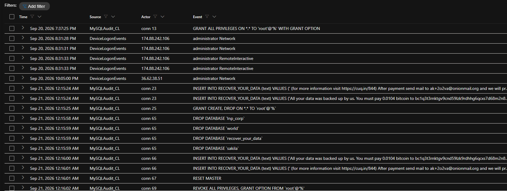
*Hunt 5.1: logons and MySQL statements merged into one timeline (EDT).*

---

## 5. MITRE ATT&CK mapping

| Tactic | Technique | Evidence | Confidence |
| :--- | :--- | :--- | :--- |
| Credential Access | T1110.001 Password Guessing | `36.62.38.51`: 2 failures then success | High |
| Credential Access | T1110.003 Password Spraying | `154.29.76.235` (1,215 attempts, 11 usernames), `218.147.202.136` (553) | High |
| Initial Access / Persistence | T1078 Valid Accounts; T1078.003 Local Accounts | MySQL `root@'%'`, Windows `administrator` | High |
| Lateral Movement | T1021.001 Remote Desktop Protocol | Type-10 session from `105.155.100.147` | High |
| Persistence | T1098 Account Manipulation | `GRANT CREATE, DROP ON *.* TO root@'%'` | High |
| Collection | T1213.006 Data from Information Repositories: Databases | `SELECT *` on 31 tables | High |
| Impact | T1485 Data Destruction | `DROP DATABASE` ×4 | High |
| Impact | T1490 Inhibit System Recovery | `RESET MASTER`, `PURGE BINARY LOGS` | High |
| Impact | T1531 Account Access Removal | `REVOKE ALL` on `root@'%'` | High |
| Impact | T1489 Service Stop | `SHUTDOWN` issued (server did not stop) | Medium (attempted) |
| Impact | T1657 Financial Theft | BTC ransom note | High |
| Discovery | T1057 Process Discovery | Task Manager opened in the RDP session | Low (intent unclear) |

**Deliberately not mapped:**
- **T1190 Exploit Public-Facing Application.** No software exploit was used; both entries were valid credentials.
- **Exfiltration techniques (e.g., T1041).** Data was read, but I have no network evidence that it left the host. A `SELECT` over a remote MySQL session *returns* the rows to the client, so theft is very likely, but I'm mapping what the logs prove.

---

## 6. Root cause, and why detection failed

### Root cause
1. **MySQL.** Port 3306 was open to the internet, and the lab setup created `root@'%'` with a weak password. Every attacker session came from an external IP. The only `localhost` sessions were mine, which rules out a pivot from RDP. This was a direct hit on 3306.
2. **Windows `administrator`.** It had a weak password, RDP and SMB were exposed, the firewall was off and there was no lockout policy. The successful `36.62.38.51` and `200.75.2.138` logons were **NTLM over SMB (445)**, not desktop sessions. Only `105.155.100.147` reached a desktop.
3. **Possible credential handoff (hypothesis).** `218.147.202.136` found the password at 15:08. Nine minutes later, `105.155.100.147` used it on its first attempt, from a named workstation and with a real desktop. Two hours earlier, that IP had only failed with a different username. This pattern fits a scanner selling or passing access to a hands-on operator, but the logs can't prove the link.

### The detection gap: the lab's MySQL parser hides real logins
MySQL **restarts connection IDs at 1 every time the service restarts** (4 times in this window). It also writes a failed login as two lines with the *same* connection ID: `Connect user@host` and then `Access denied`.

The lab's analytics query treats any connection ID that **ever** failed as a failure. Its failure list also has **no time filter**. So after a restart, a new successful login that reuses an old ID disappears. Across my 5-day export this logic:
- **hid 13 real sessions**, including the ransom bot's first login (conn 19) and its `GRANT` (conn 25);
- **labelled 106 rows "LogonSuccess"** that were never followed by a statement (84 `appuser`, 13 with no user or IP, 9 from `27.223.84.195`).

**Reproduction.** I ran this on the same server, 26 Sep 00:42–01:08 UTC. I generated failed logins and ran `Restart-Service MySQL80`, after which the IDs reset from 20 to 8. Then I logged in successfully 9 times (IDs 10–18), each followed by `SELECT CONNECTION_ID()`.

| Query | Successful logins shown | Hidden |
| :--- | :--- | :--- |
| Lab rule (1-day window) | 10, 12, 13 | **11, 14–18**: each ID had an `Access denied` earlier (14–18 before the restart; 11 on 21 Sep) |
| My fix (Hunt 6.1) | 10–18 (9 of 9) | none |
| Raw log | 10–18, each `Connect` + 2 `Query`, no `Access denied` | – |

**The fix (Hunt 6.1).** Match `Access denied` to its `Connect` line by connection ID **within 2 seconds**, and count a login as successful **only if a statement follows it within an hour**.

```kql
// paste the setup block from the Appendix first
let Denied = MySQL | where Detail has "Access denied" | project ConnId, DTime = TimeGenerated;
let Stmts  = MySQL | where Command == "Query" | project ConnId, QTime = TimeGenerated;
MySQL
| where Command == "Connect" and Detail contains "@" and Detail !has "Access denied"
| extend User = extract(@"^([^@\s]+)@", 1, Detail), SrcIP = extract(@"@(\S+)\s+on", 1, Detail)
| join kind=leftouter Denied on ConnId
| summarize Denied = countif(abs(datetime_diff('second', DTime, TimeGenerated)) <= 2) by TimeGenerated, ConnId, User, SrcIP
| where Denied == 0                       // drop the user@host line written just before each "Access denied"
| join kind=leftouter Stmts on ConnId
| summarize Stmts = countif(QTime between (TimeGenerated .. TimeGenerated + 1h)) by TimeGenerated, ConnId, User, SrcIP
| summarize Sessions = count(), Confirmed = countif(Stmts > 0), First = min(TimeGenerated) by SrcIP, User
| order by First asc
```
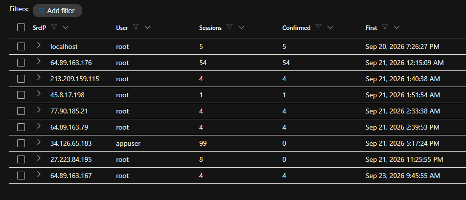
*Hunt 6.1: confirmed MySQL sessions per source. `appuser` (99) and `27.223.84.195` (8) have zero confirmed sessions.*

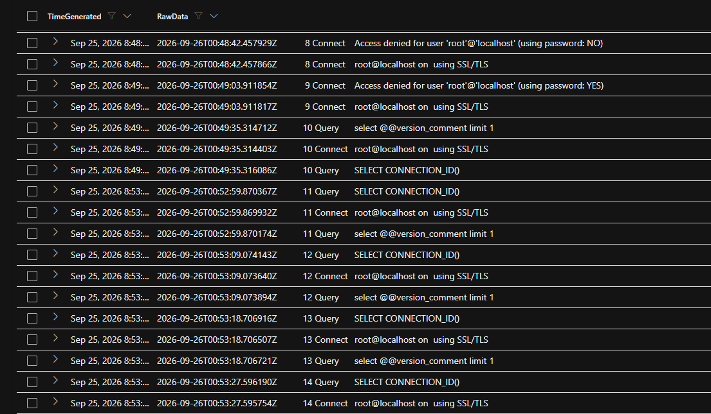
*Reproduction: raw log after the restart. Failed IDs 8–9, successful IDs 10–14 each followed by queries.*

<details>
<summary>More reproduction screenshots</summary>

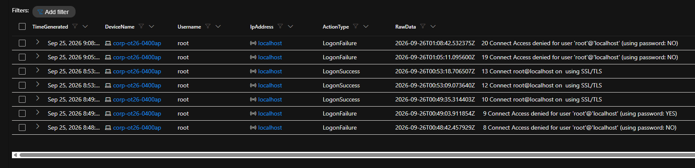
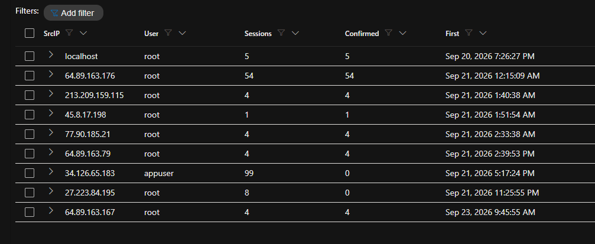
</details>

---

## 7. Host forensics: investigation package comparison

I compared the **baseline** package (20 Sep 23:39, before any attacker login) with the **mid-incident** package (23 Sep 18:05, about 2 h 45 m after the RDP intrusion), and parsed `Security.evtx` from the second one.

| Artifact | Change from baseline | Assessment |
| :--- | :--- | :--- |
| Services | +48 per-user service instances (`*_d24c5`, `*_120966e`) | Windows creates these for every new logon session (two new sessions). Benign |
| Scheduled tasks | +6: OneDrive Startup/Update/Reporting and SoftLanding for the `administrator` profile, created 15:20–15:51 | Created by Windows for the intruder's logon session. No attacker task |
| Autoruns / Run keys | Only the per-user services above, firewall (BFE) filters and display-state values | No attacker persistence |
| Local groups | No change | No accounts added to Administrators |
| Logged-on users | `administrator`: session from 15:17, **Disconnected, idle 2 h 46 m** | The intruder disconnected around 15:19 and never logged off |
| SMB sessions | None | – |
| Temp directories | `administrator` temp: OneDrive and Edge files only | No tools or staged files |
| Security.evtx | Covers **only 23 Sep 08:17–18:05** (log rolled over; no 1102 clear event). 1,906 failed logons in under 10 h | No log tampering, but no Security-log coverage for 21–22 Sep |

**What the Security log added:**
- the intruder's workstation name (`DESKTOP-OU4DIV8`);
- the spray volumes (`154.29.76.235`: 1,215; `218.147.202.136`: 553; `188.252.76.146`: 133);
- `105.155.100.147`'s earlier failures as AZUREUSER;
- `194.195.120.133` as a new source;
- the two failed attempts on the lab-owner account at 15:19:16–18 (status `0xC000006A`, wrong password for a valid user).

**Correction to v1.0.** I previously said three IPs logged in "without a single failure". The Security log shows `218.147.202.136` and `105.155.100.147` both failed first. Only `200.75.2.138` shows no failures, and its day (21 Sep) isn't covered by the Security log.

The **isolation package (25 Sep 22:11)** was collected but not analysed for this report.

---

## 8. Response actions

| Phase | Action | Status | Evidence |
| :--- | :--- | :--- | :--- |
| Containment | Host isolated in Defender (25 Sep 22:11:28) | Done | MDE action center |
| Containment | Investigation packages: baseline (20 Sep), mid-incident (23 Sep), isolation (25 Sep) | Done (2 of 3 analysed) | Section 7 |
| Containment | Windows Firewall re-enabled on all profiles (22:35:27) | Done | DeviceRegistryEvents (Hunt 7.2) |
| Containment | NSG inbound 3389/3306 closed to the internet (analyst IP only) | Done | Analyst record. No post-isolation external logons or MySQL connects (Hunt 7.1) |
| Containment | IOC IPs blocked at the NSG | Done | Analyst record |
| Eradication | `administrator` deleted, `guest` disabled, owner password rotated, full Defender scan | Done | Analyst record |
| Eradication | MySQL: `DROP USER 'root'@'%'`, ransom DB dropped, `mysql.user` checked for unknown accounts (`appuser`) | Done | Analyst record |
| Eradication | Rebuild the VM from a clean image (an unknown party had an interactive admin session) | **Open** | – |
| Recovery | `lnp_corp` and the sample DBs restored from backup (no point-in-time recovery; binlogs gone) | Done | Analyst record |
| Recovery | Do not pay; treat the data as disclosed; watch the IOC IPs for 30 days | **Open** | – |

"Analyst record" means I did it but did not export telemetry proving it. I have only claimed actions I carried out.

---

## 9. Lessons learned and detection improvements

I exposed this box on purpose, so "don't expose it" is not the interesting lesson. These are the ones I'd take into a SOC.

1. **P1: Fix the parser before trusting the alert.** Correlate failures within seconds, not across all time, and confirm a login by the activity that follows it (Hunt 6.1). A detection that drops the attacker's first successful login is worse than no detection, because it looks like coverage.
2. **P1: Alert on attacker actions, in near real time.** A logon rule on a schedule cannot beat a 55-second wipe. The NRT rule below fires on destructive statements, and it should trigger automation (block the source IP, stop the service).
3. **P1: Never expose 3306 or 3389, and never create `root@'%'`.** Use Bastion/JIT or an allowlist, and host-bound DB accounts. Here the admin password lasted 3 h 41 m and the database 5 h 52 m.
4. **P2: Binary logs are not backups.** The attacker deleted them in one second. Keep offline, tested backups.
5. **P2: Get the export scope right first.** Network events without IPs, a registry export from the wrong day and devices, and a logon export limited to two accounts stalled the persistence and exfiltration questions until I re-exported (section 10).
6. **P3: Catch slow and distributed brute force.** `37.247.230.82` stayed under hourly thresholds at one try every ~16 min. Alert on 5+ failures per source per 24 h, or on a success after failures from the same IP, and set an account lockout policy.

**Hunt 9.1: proposed NRT rule for destructive MySQL statements**
```kql
MySQLAudit_CL
| where RawData has "Query"
| extend RawData = replace_string(RawData, "\t", " ")
| extend DeviceName = tostring(split(_ResourceId, "/")[-1]),
         ConnId = toint(extract(@"^\S+\s+(\d+)\s", 1, RawData)),
         Stmt = trim(@"\s+", extract(@"(?s)\sQuery\s(.*)$", 1, RawData))
| where Stmt matches regex @"(?i)^(DROP\s+(DATABASE|SCHEMA|TABLE)|REVOKE|RESET\s+MASTER|PURGE\s+BINARY|SHUTDOWN|GRANT\s)"
     or Stmt contains "RECOVER_YOUR_DATA"
| project TimeGenerated, DeviceName, ConnId, Stmt
```
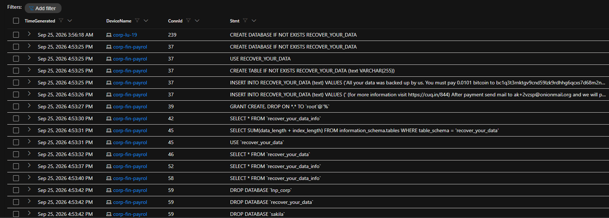
*Hunt 9.1 run against the incident window. Its first match is the `GRANT` at 04:15:25, 33 s before the first `DROP`. An NRT rule runs about once a minute, so it would have alerted within about a minute of the attack instead of 13 minutes after.*

**Hunt 9.2: slow brute force and success-after-failure**
```kql
DeviceLogonEvents
| where DeviceName == VM_MDE and Timestamp between (Start .. End)   // as a scheduled rule: Timestamp > ago(1d)
| where RemoteIPType == "Public"
| summarize Failures = countif(ActionType == "LogonFailed"), Successes = countif(ActionType == "LogonSuccess"),
            First = min(Timestamp), Last = max(Timestamp) by RemoteIP, AccountName
| where Failures >= 5 or (Failures > 0 and Successes > 0)
```
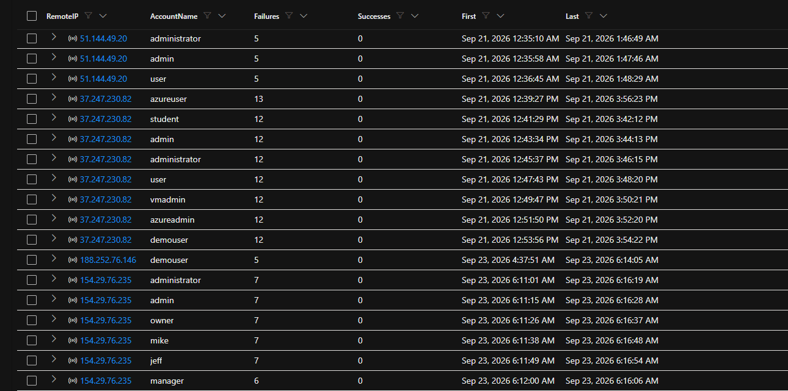

---

## 10. Evidence and limitations

| Source | Coverage (UTC) | Used for | Limitation |
| :--- | :--- | :--- | :--- |
| `MySQLAudit_CL` (auth 214 rows, queries 422 rows) | 09-20 23:26 → 09-25 22:02 | MySQL logons and statements | Statements only, not results; lab parser unreliable (section 6) |
| `DeviceLogonEvents` | 09-21 00:31 → 09-23 15:17 | Windows logons | First export covered only `administrator`/`guest`; re-queried (Hunts 1.1, 6.2) |
| `DeviceProcessEvents` (4,785), `DeviceFileEvents` (5,258) | 09-20 22:24 → 09-25 22:11 | Session activity, drops | MDE doesn't log every file operation |
| `DeviceNetworkEvents` (8,737) | same | Inbound/outbound | First export lacked RemoteIP and ports; re-exported (Hunt 8.1). Outbound: Windows, Edge, OneDrive, Defender and Azure agent only |
| `DeviceRegistryEvents` | re-exported, 1,636 rows | Persistence, firewall | First export had the wrong scope (47 devices, last 24 h) |
| `NTANetAnalytics`, `SecurityIncident` | window | Denied outbound flows (7 NTP, 1 my own), alert timing | – |
| Investigation packages | 09-20 23:39, 09-23 18:05 | Host-state diff, Security.evtx | Isolation package (09-25) not analysed |

**What I could not determine:**
- the exact passwords used;
- whether any data left the host, and how much;
- what the RDP intruder did after 15:18:45 (only background processes, and the session went idle around 15:19);
- whether a MySQL `appuser` account exists;
- Security-log events for 21–22 Sep (the log rolled over).

The Security log recorded 1,906 failed logons on 23 Sep alone, while Hunt 1.1 counted 340 public attempts in `DeviceLogonEvents` across all 5 days. I haven't reconciled that gap. It suggests `DeviceLogonEvents` alone undercounts brute force on this host.

**Time handling.** The portal exported and displays EDT (UTC−4). I converted all text to UTC and checked it against MySQL's own UTC timestamps (within 1 s).

---

## 11. Conclusion and final scope

**Confirmed**
- MySQL `root@'%'` was compromised by an automated ransom bot. All data was read, all four databases were dropped, recovery was blocked and a 0.0104 BTC note was left.
- The Windows `administrator` password was compromised by several sources. One operator (`105.155.100.147` / `DESKTOP-OU4DIV8`) had an interactive RDP session.

**Not found**
- Malware, persistence, new accounts, outbound C2 or log clearing on the Windows host (MDE telemetry and package comparison).

**Not determined**
- Data exfiltration volume, the intruder's actions after the session went idle, and host state between 23 Sep 18:05 and isolation.

**The most important finding is a detection problem, not an attack.** The lab's MySQL parser hid real logins. I reproduced the bug and wrote a corrected query, and the proposed NRT rule would have alerted within about a minute of the attack instead of 13 minutes after the wipe.

---

## Appendix: KQL hunts

Paste this setup block above every hunt:
```kql
let VM_MDE = "corp-ot26-0400a";      // MDE name (truncated to 15 chars)
let VM_ARM = "corp-ot26-0400ap";     // Azure resource name
let Start = datetime(2026-09-20T22:24:02Z);
let End   = datetime(2026-09-25T22:11:29Z);
let MySQL = MySQLAudit_CL
| where TimeGenerated between (Start .. End) and _ResourceId endswith VM_ARM
| extend RawData = replace_string(RawData, "\t", " ")
| extend ConnId  = toint(extract(@"^\S+\s+(\d+)\s", 1, RawData)),
         Command = extract(@"^\S+\s+\d+\s+(\w+)", 1, RawData),
         Detail  = trim(@"\s+", extract(@"(?s)^\S+\s+\d+\s+\w+(.*)$", 1, RawData));
```

<details>
<summary><b>Hunt 1.1: logon scoreboard, all accounts</b></summary>

```kql
DeviceLogonEvents
| where DeviceName == VM_MDE and Timestamp between (Start .. End) and RemoteIPType == "Public"
| summarize Attempts = count(), Successes = countif(ActionType == "LogonSuccess"), SourceIPs = dcount(RemoteIP) by AccountName
| order by Attempts desc
```
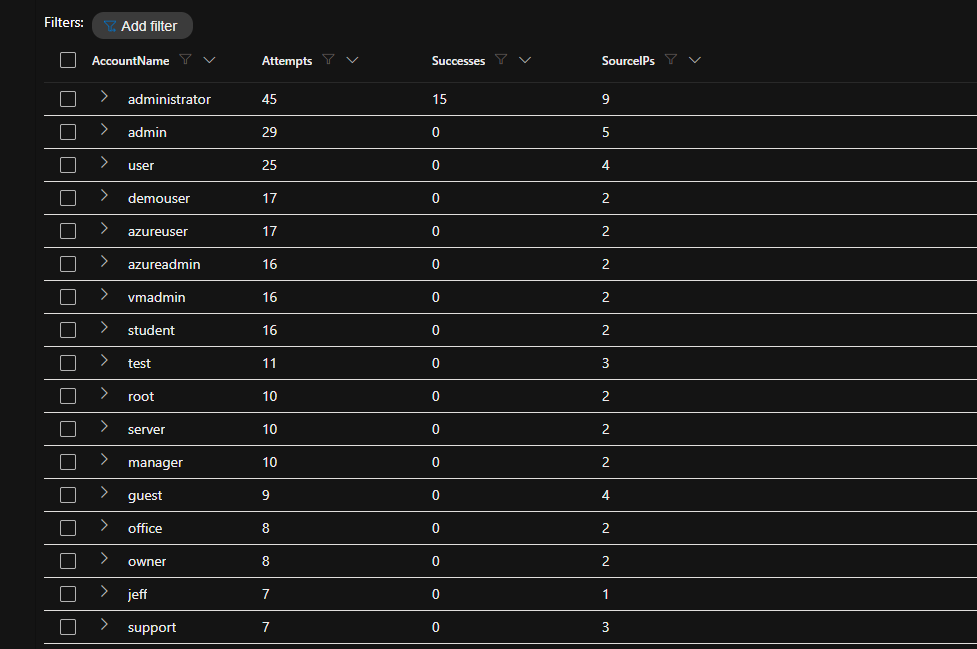
</details>

<details>
<summary><b>Hunt 2.1: when the analytics rules fired · Hunt 2.2: asset record</b></summary>

```kql
SecurityIncident
| where CreatedTime between (Start .. End + 1d) and Title contains "OT26-0400AP"
| summarize arg_max(LastModifiedTime, *) by IncidentNumber
| project CreatedTime, IncidentNumber, Title, Severity, Status
| order by CreatedTime asc
```
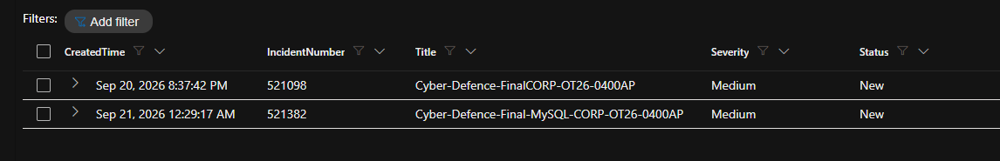

```kql
DeviceInfo
| where DeviceName == VM_MDE
| summarize arg_max(Timestamp, *)
| project Timestamp, DeviceName, OSPlatform, OSBuild, PublicIP, OnboardingStatus
```
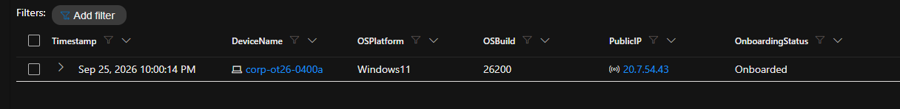
</details>

<details>
<summary><b>Hunt 3.1: destructive statements · Hunt 3.2: what was read</b></summary>

```kql
MySQL
| where Command == "Query"
| where Detail has_any ("DROP","RENAME","TRUNCATE","DELETE","INSERT","CREATE","GRANT","REVOKE","RESET","PURGE","SHUTDOWN")
| project TimeGenerated, ConnId, Detail
| order by TimeGenerated asc
```
```kql
MySQL
| where Command == "Query" and Detail startswith "SELECT * FROM"
| summarize Reads = count(), Tables = make_set(extract(@"`(\w+)`", 1, Detail)) by bin(TimeGenerated, 1m)
```
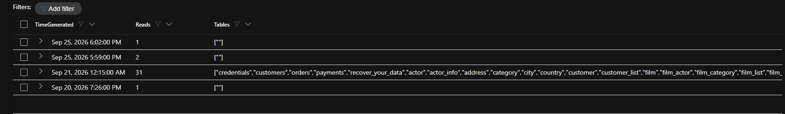
</details>

<details>
<summary><b>Hunt 4.1: extract the ransom note's IOCs · Hunt 4.2: IOC IPs across Defender tables</b></summary>

```kql
MySQL
| where Command == "Query" and Detail contains "INSERT INTO RECOVER_YOUR_DATA"
| extend BTC = extract(@"(bc1[a-z0-9]{25,})", 1, Detail),
         Email = extract(@"([\w.+-]+@onionmail\.org)", 1, Detail),
         URL = extract(@"(https?://[^\s)]+)", 1, Detail),
         DataId = extract(@"DATAID is: (\w+)", 1, Detail)
| project TimeGenerated, ConnId, BTC, Email, URL, DataId
```
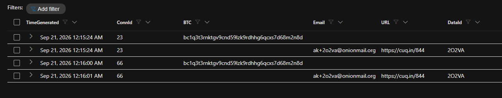

```kql
let IOC_IPs = dynamic(["36.62.38.51","200.75.2.138","218.147.202.136","105.155.100.147",
  "64.89.163.176","64.89.163.79","64.89.163.167","213.209.159.115","77.90.185.21","45.8.17.198"]);
union withsource = Table DeviceLogonEvents, DeviceNetworkEvents
| where DeviceName == VM_MDE and Timestamp between (Start .. End) and RemoteIP in (IOC_IPs)
| summarize Events = count(), First = min(Timestamp), Last = max(Timestamp) by RemoteIP, Table, ActionType
| order by First asc
```
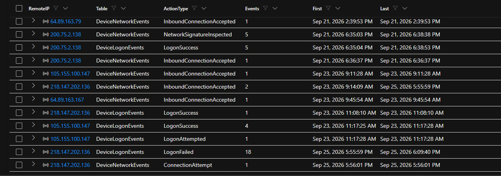
</details>

<details>
<summary><b>Hunt 5.1: merged timeline</b></summary>

```kql
let Logons = DeviceLogonEvents
| where DeviceName == VM_MDE and Timestamp between (Start .. End)
| where RemoteIPType == "Public" and ActionType == "LogonSuccess"
| project Time = Timestamp, Source = "DeviceLogonEvents", Actor = RemoteIP, Event = strcat(AccountName, " ", LogonType);
let Db = MySQL
| where Command == "Query" and Detail has_any ("DROP","INSERT","GRANT","REVOKE","RESET","PURGE","SHUTDOWN")
| project Time = TimeGenerated, Source = "MySQLAudit_CL", Actor = strcat("conn ", ConnId), Event = Detail;
union Logons, Db
| order by Time asc
```
</details>

<details>
<summary><b>Hunt 6.2: Windows logon details (protocol, failure reason)</b></summary>

```kql
DeviceLogonEvents
| where DeviceName == VM_MDE and Timestamp between (Start .. End) and RemoteIPType == "Public"
| where AccountName in~ ("administrator", "guest")
| project Timestamp, RemoteIP, AccountName, ActionType, LogonType, Protocol, FailureReason, InitiatingProcessFileName
| order by Timestamp asc
```
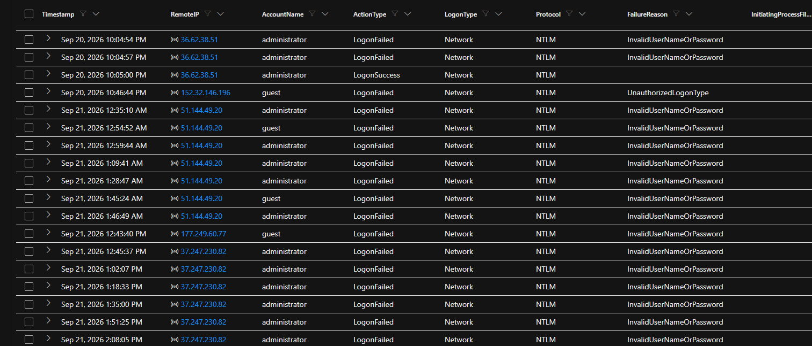
</details>

<details>
<summary><b>Hunt 7.1: is containment holding? · Hunt 7.2: firewall state</b></summary>

```kql
let After = datetime(2026-09-25T22:11:29Z);
union
(DeviceLogonEvents
 | where DeviceName == VM_MDE and Timestamp > After and RemoteIPType == "Public"
 | project Time = Timestamp, Event = strcat("Logon ", ActionType, " ", AccountName), From = RemoteIP),
(MySQLAudit_CL
 | where _ResourceId endswith VM_ARM and TimeGenerated > After and RawData has "Connect"
 | project Time = TimeGenerated, Event = "MySQL connect", From = extract(@"@(\S+)", 1, RawData))
| order by Time asc
```
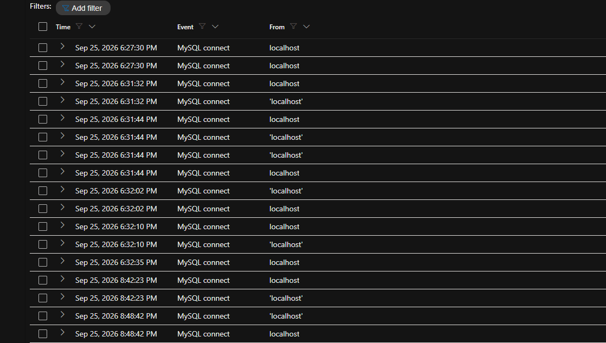
*Only localhost connections after isolation (my own activity on the VM). No external logons.*

```kql
DeviceRegistryEvents
| where DeviceName == VM_MDE and Timestamp between (Start - 1d .. now())
| where RegistryKey has "FirewallPolicy" and RegistryValueName == "EnableFirewall"
| project Timestamp, RegistryKey, PreviousRegistryValueData, RegistryValueData, InitiatingProcessFileName
| order by Timestamp asc
```
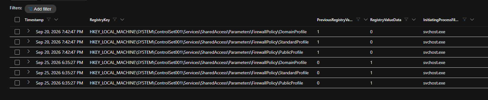
</details>

<details>
<summary><b>Hunts 8.1–8.3: corrected re-exports</b></summary>

```kql
// 8.1 network events with the columns that matter
DeviceNetworkEvents
| where DeviceName == VM_MDE and Timestamp between (Start .. End)
| project Timestamp, ActionType, RemoteIP, RemotePort, LocalPort, Protocol, InitiatingProcessFileName, InitiatingProcessAccountName
```
```kql
// 8.2 registry events for this host and window
DeviceRegistryEvents
| where DeviceName == VM_MDE and Timestamp between (Start .. End)
| where RegistryKey has_any ("Run","RunOnce","Services","Winlogon","Terminal Server","FirewallPolicy","Lsa")
| project Timestamp, ActionType, RegistryKey, RegistryValueName, RegistryValueData, InitiatingProcessFileName, InitiatingProcessAccountName
```
```kql
// 8.3 outbound traffic blocked by the tenant egress policy
NTANetAnalytics
| where TimeGenerated between (Start .. End) and SrcVm endswith VM_ARM and DeniedOutFlows >= 1
| project TimeGenerated, FlowType, FlowStatus, SrcIp, DestIp, DestPort
```
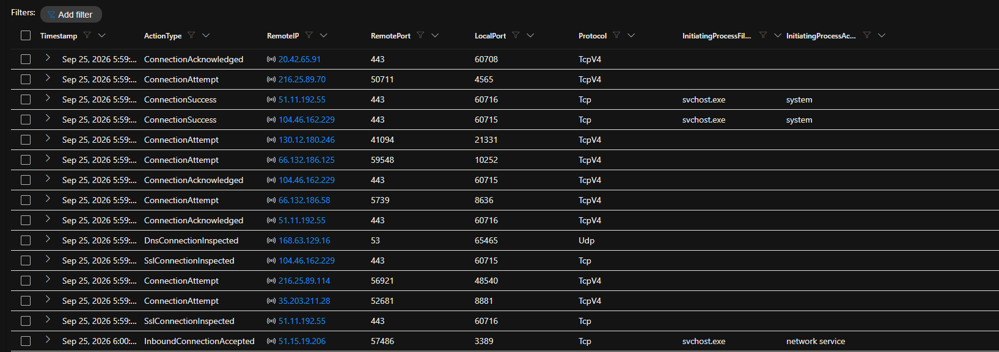
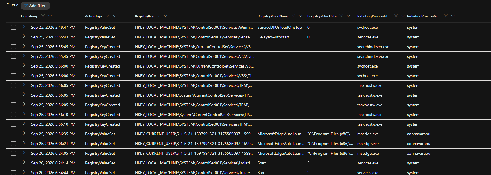
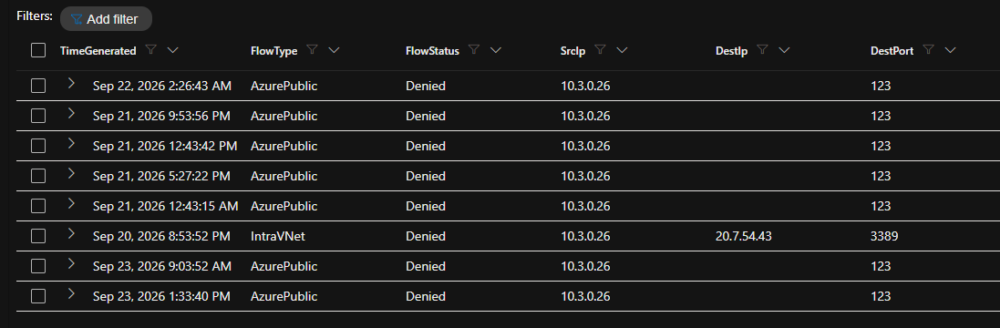
</details>

<details>
<summary><b>Hunt 10.1: geolocation of attack sources (map)</b></summary>

```kql
let Start = datetime(2026-09-20T22:24:02Z); let End = datetime(2026-09-25T22:11:29Z);
let Win = DeviceLogonEvents
| where DeviceName == "corp-ot26-0400a" and Timestamp between (Start .. End) and RemoteIPType == "Public"
| summarize Attempts = count() by RemoteIP, Service = "RDP/SMB";
let Sql = MySQLAudit_CL
| where TimeGenerated between (Start .. End) and _ResourceId endswith "corp-ot26-0400ap" and RawData has "Connect"
| extend RemoteIP = extract(@"@(\d+\.\d+\.\d+\.\d+)", 1, RawData)
| where isnotempty(RemoteIP)
| summarize Attempts = count() by RemoteIP, Service = "MySQL";
union Win, Sql
| where RemoteIP != "<analyst IP redacted>"
| extend Geo = geo_info_from_ip_address(RemoteIP)
| extend Latitude = toreal(Geo.latitude), Longitude = toreal(Geo.longitude), Country = tostring(Geo.country)
| where isnotnull(Latitude)
```
Rendered as a Map visualization in a Sentinel workbook (size and heatmap colour by Attempts).
</details>

---

*Personal lab project. The attacker IPs and IOCs are real internet traffic observed against my honeypot and are shared for defensive use. The lab data was synthetic.*
